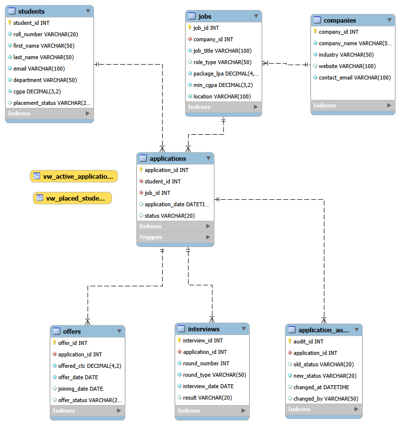

# Campus Placement Tracker

A relational database system built using **MySQL 8.x** to manage campus recruitment, including student applications, job postings, interview rounds, offers, and application status tracking.

## Entity-Relationship Diagram



## Features

- **7 Normalized Tables:** Students, Companies, Jobs, Applications, Interviews, Offers, and Application Audit.
- **Data Integrity:** Primary keys, foreign keys, CHECK and UNIQUE constraints.
- **Triggers:** Automated application status auditing.
- **Views:** Reusable reporting using SQL views.
- **Transactions:** ACID-based offer acceptance and placement updates.
- **Advanced SQL:** Subqueries, CTEs, and window functions.
- **Indexing:** Optimized departmental eligibility queries.

## Tech Stack

- MySQL 8.x
- SQL

## Project Structure

```text
Campus-Placement-Tracker/
├── 01_schema.sql
├── 02_seed_data.sql
├── 03_views_and_triggers.sql
├── 04_analytical_queries.sql
├── docs/
│   └── er_diagram.png
└── README.md
